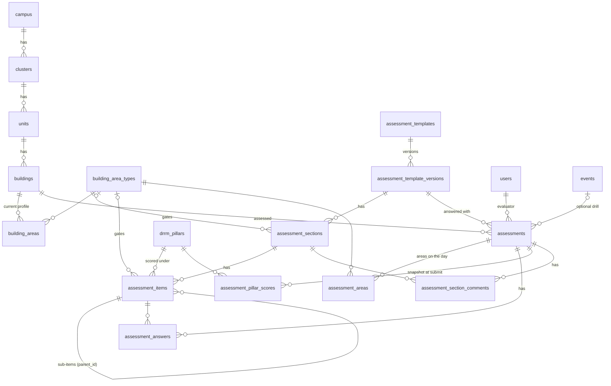

# [DRRM-015] Feature Plan: MATATAG building assessment

- **Status:** `[In Review]`
- **Target Branch / PR:** `feat/DRRM-015-assessment-form`, in this worktree (`workspaces/drrmh-irs/Form`) only, built in three phases (Section 6)
- **Test environment:** this worktree's `.env.development.local`, a Supabase project separate from the one the `dev` worktree uses. Schema changes, the seed and test assessments go there. Production gets the SQL and the seed later, through the Supabase SQL editor.
- **Owner / Author:** DevJom
- **Source:** request to bring the UP Resilience Institute's **MATATAG** checklist (_Monitoring and Assessment Tool for Area Threats and Accident Generators_, Ver. July 25, 2025, last updated 2026-06-29; reference copy `MATATAG/public/matatag-reference.pdf`) into the IRS as an "Assessment" tool for ERT members. Branched from `dev` at `7e4ab27` (after DRRM-014).

---

## 1. Problem Statement & Motivation

MATATAG is a 26-page paper checklist that an evaluator walks through a building with. It has 17 sections (Crisis plans, Exterior, Doors/windows, Lighting & electrical, Fire protection, Walls/floors/ceilings, Stairwells, Exits & corridors, Bathrooms, Custodial, Offices, Classrooms, Laboratories, Playgrounds, Gym, Swimming pool, Dormitories) and **211 answerable items**. Each item is answered YES / NO / N/A and can have remarks. Each section has a total, and there's an overall score.

On paper the evaluator flips through every page and marks N/A by hand for whatever the building doesn't have. Most buildings don't have a pool, a playground, dorms _and_ labs. About 40% of the items (84) are the same question repeated for each type of area ("are fire extinguishers accessible?" for Corridors, Bathrooms, Offices, Classrooms, Labs, Gym, Dorms), so a missing area costs up to 12 scattered N/As plus its whole section.

**Who:** ERT members, in the field, on a phone (Section 5.6 covers access).
**Why now:** DRRM-H wants periodic building inspections recorded with the same tool that holds incident reports, so results can be compared over time per building and scoped per campus like everything else.

---

## 2. Requirements & User Stories

- **As an ERT member**, I answer a short pre-screen about the building first (floors and which areas it has), so I only see the questions that apply to it.
- **As an ERT member**, I can go back to any earlier section, including the pre-screen, while answering. Changing the pre-screen doesn't throw away answers I've already given.
- **As an ERT member**, I don't lose a half-done assessment if the signal drops or I close the tab, and I can submit with no connection.
- **As an ERT member**, after sign-in I choose between **Status report** and **Assessment**, and I can switch between them from the top bar.
- **As an admin**, I can see each building's latest score and open any assessment read-only, scoped by the campus switcher.
- **As an admin**, I can see on the dashboard how the campus does in each of the four DRRM pillars (Prevention and Mitigation, Preparedness, Response, Rehabilitation and Recovery). I can drill from the campus to a cluster, a unit and a building, and see the latest assessments against the previous ones.
- **As an admin**, for one building I can compare any two of its assessments (default: previous vs latest) to see whether fixes after an incident improved its score.
- **As a super admin**, I can do the same for any campus, or for all campuses at once.
- **As a super admin**, I can add and edit the checklist questions without breaking past assessments.
- **As anyone reading questions**, I choose English + Filipino, English only, or Filipino only in My profile.

Acceptance criteria:

- [ ] `/home` (ERT landing) shows two cards, Status report and Assessment. The ERT top bar has a Report | Assessment switch. The Assessment entry shows only when `canUseAssessment(profile)` is true.
- [ ] Pre-screen = building details + floors + one "which areas does this building have?" checklist, pre-filled from the building's last assessment.
- [ ] Only applicable items show. The live question count updates as areas are ticked.
- [ ] Back / Next between sections, plus a section index to jump anywhere (pre-screen included). Unticking an area sets its answers aside (kept in the draft). Ticking it again restores them.
- [ ] Every applicable item needs YES / NO / N/A before submit. The review screen lists missing items and jumps to them.
- [ ] Reverse-scored items (II.3, VI.1.x, VI.9: marked `*` in the PDF) score NO as the safe answer and say so in the UI.
- [ ] A YES on VI.1.x (visible wall cracks) flags the assessment "Needs structural follow-up".
- [ ] Scores: section %, pillar % and overall %, N/A and pre-screened-out items excluded.
- [ ] Every scored item belongs to exactly one DRRM pillar (Section 4.1), enforced in the database. Pillar 4 (one item) is shown as "Public Service Continuity Plan: In place / Missing / N/A".
- [ ] Dashboard "Building safety" section (Section 4.3):
  - Drills Campus → Cluster → Unit → Building, with a breadcrumb and the level in the URL.
  - Each aggregate level shows the current pooled overall and pillar scores with the like-for-like change since the previous assessments, a chart with one entry per child, a children table, section scores and the most-failed items.
  - The building level shows the history line and an A/B comparison (default #n−1 vs #n; both pickable) of overall, pillar and section scores.
  - Admins are locked to their own campus server-side; super admins can pick any campus or all.
- [ ] Draft autosaves to IndexedDB. Submitting offline queues it; it replays like field reports.
- [ ] Server rejects assessment writes from anyone who isn't allowed (checked server-side, not only in the UI).
- [ ] Admin `/assessments`: Buildings tab (latest score per building) and Assessments tab (all), campus-scoped. Read-only detail page.
- [ ] Super admin `/assessments/checklist`: edit wording in place; structural changes go into a new draft version that is then published.
- [ ] Question language preference (Both / English / Filipino) in My profile, saved per device.
- [ ] Light and dark mode; phone, tablet and web layouts.

Non-goals (this ticket): A4 print/PDF of an assessment, photos per item, resuming a draft on another device, score bands/ratings, the Safety Officer position rule (designed for, not switched on).

---

## 3. Pre-screening: fewest questions, full coverage

### 3.1 The rule

A pre-screen question earns its place only if a single answer removes **a whole section or several scattered items**. A rare thing that affects one item (propane tanks II.6, aquariums XII.1, fume hoods XIII.4, gas valves XIII.6) stays as an in-place N/A. Asking about it up front would cost the same tap and add a screen. The data model still supports gating any item behind an area (Section 5), so a super admin can promote one later if it proves noisy.

### 3.2 The pre-screen (2 screens)

**Screen A: Building details** (the PDF header)

| Field                       | Source                                                                       |
| --------------------------- | ---------------------------------------------------------------------------- |
| Campus                      | the evaluator's profile (read-only)                                          |
| Cluster                     | the evaluator's profile, changeable                                          |
| College / Department / Unit | required; defaults to the evaluator's unit, changeable                       |
| Building                    | pick from the unit's buildings, or **Add a building** (name)                 |
| Incident Commander          | free text (the IC may not have an IRS account)                               |
| Linked event / drill        | optional: the campus's ongoing events and ones completed in the last 30 days |
| Evaluator, Date, Time start | automatic (signed-in user, when the draft is started)                        |
| Time end                    | automatic (when submitted)                                                   |

**Screen B: About the building**

1. **How many floors?** (number, pre-filled from the building)
2. **Which of these does the building have?** (checklist, pre-filled from the building's last assessment, with "From the last assessment on _date_ — check it's still right")

| Area                                              | Removes when unticked                                                                                    | Items |
| ------------------------------------------------- | -------------------------------------------------------------------------------------------------------- | ----- |
| Corridors                                         | 11 area sub-items (III.4.1, IV.1.2, IV.2.1, IV.3.1, V.5.1, V.6.1, V.7.1, VI.1.1, VI.2.1, VI.7.1, VI.8.1) | 11    |
| Bathrooms                                         | Section IX (7) + 12 area sub-items                                                                       | 19    |
| Offices                                           | Section XI (5) + 12 area sub-items                                                                       | 17    |
| Classrooms / multi-purpose rooms / libraries      | Section XII (9) + 12 area sub-items                                                                      | 21    |
| Laboratories                                      | Section XIII (16) + 12 area sub-items                                                                    | 28    |
| Athletic facilities / gymnasium                   | Section XV (5) + 12 area sub-items                                                                       | 17    |
| Dormitories                                       | Section XVII (20) + 12 area sub-items                                                                    | 32    |
| Playground                                        | Section XIV                                                                                              | 13    |
| Swimming pool                                     | Section XVI                                                                                              | 4     |
| Stairwells (ticked automatically when floors ≥ 2) | Section VII                                                                                              | 7     |

**Floors < 3** also removes the sprinkler items, V.6.x (each also needs its area) and XVII.13 ("sprinklers should be installed in buildings with 3 floors or above").

The "12 area sub-items" for each area other than corridors are III.2.x, III.4.x, IV.1.x, IV.2.x, IV.3.x, V.5.x, V.6.x, V.7.x, VI.1.x, VI.2.x, VI.7.x and VI.8.x.

### 3.3 Always asked (42 items)

Section I Crisis plans (12), II Exterior & grounds (7), VIII Exits & corridors (8) and X Custodial (3). Also III.1 and III.3, IV.1.1 (exterior lighting), V.1–V.4, and VI.3–VI.6 and VI.9. Every building has an exterior and exits, so these need no pre-screen.

`42 always + 169 gated = 211`.

### 3.4 What it saves

| Building                                                                 | Items asked | Saved |
| ------------------------------------------------------------------------ | ----------- | ----- |
| 2-floor admin building: corridors, bathrooms, offices, stairs            | 93          | 56%   |
| 4-floor college: corridors, bathrooms, offices, classrooms, labs, stairs | 145         | 31%   |
| 4-floor dormitory: corridors, bathrooms, offices, dorms, stairs          | 128         | 39%   |
| Everything ticked, ≥ 3 floors                                            | 211         | 0%    |

### 3.5 Backtracking while answering

- The assessment is a stepper: **Details → About the building → one step per applicable section → Review**. Back / Next on every step.
- A **section index** (bottom sheet on phone, side list on web) lists every step with "answered / total", and any step can be opened from it, including the two pre-screen steps.
- **Changing the pre-screen mid-way**
  - _Ticking an area_ adds its items, unanswered. The index shows which sections grew.
  - _Unticking an area that already has answers_ asks first: "12 answers for Laboratories will be set aside. They come back if you tick it again." The answers stay in the draft but aren't shown or scored. On submit, only applicable items are sent.
  - _Floors changed across 3_ works the same way for the sprinkler items.
- **Review** shows each section's score, the unanswered items (tap → jumps to the item), and any flags. Submit is disabled until nothing is unanswered.

---

## 4. DRRM pillar metrics

### 4.1 Every item belongs to one pillar

The requester mapped every MATATAG item to one of the four DRRM pillars (RA 10121; the same four as `src/lib/pillars.ts` from DRRM-014). Checked against the checklist, the mapping is a clean partition: each of the 211 scored items is in exactly one pillar, with no gaps and no overlaps.

| Pillar (`code`)                                            | MATATAG items                                                                                                                                                                                                                                                                                                                | Items | Always asked |
| ---------------------------------------------------------- | ---------------------------------------------------------------------------------------------------------------------------------------------------------------------------------------------------------------------------------------------------------------------------------------------------------------------------- | ----- | ------------ |
| 1. Prevention and Mitigation (`prevention-mitigation`)     | II.1–7, III.1, III.3, III.4.1–4.7, IV.1.1–1.8, IV.2.1–2.7, IV.3.1–3.7, V.6.1–6.7, VI.1–9 (incl. 1.1–1.7, 2.1–2.7, 7.1–7.7, 8.1–8.7), VII.1–2, VII.4–7, VIII.7, IX.1–7, X.1–3, XI.1–4, XII.1–8, XIII.1–2, XIII.4–5, XIII.9–11, XIII.15–16, XIV.1–13, XV.1–5, XVI.1, XVI.3–4, XVII.2–3, XVII.5, XVII.7–11, XVII.13–15, XVII.18 | 149   | 19           |
| 2. Preparedness (`preparedness`)                           | I.1–2, I.3.1, I.3.2, I.3.4, I.4–8, V.1–2, V.4, V.7.1–7.7, XIII.14, XVII.1, XVII.4, XVII.16                                                                                                                                                                                                                                   | 24    | 13           |
| 3. Response (`response`)                                   | I.9, III.2.1–2.6, V.3, V.5.1–5.7, VII.3, VIII.1–6, VIII.8, XI.5, XII.9, XIII.3, XIII.6–8, XIII.12–13, XVI.2, XVII.6, XVII.12, XVII.17, XVII.19–20                                                                                                                                                                            | 37    | 9            |
| 4. Rehabilitation and Recovery (`rehabilitation-recovery`) | I.3.3 (Public Service Continuity Plan)                                                                                                                                                                                                                                                                                       | 1     | 1            |

- **The pillar goes on the item, not the section.** Sections cut across pillars: I spans pillars 2, 3 and 4; V, VII, VIII, XIII, XVI and XVII each span two or three. Sub-items can differ from their siblings too: I.3.3 is Recovery while I.3.1, I.3.2 and I.3.4 are Preparedness.
- **"Always asked"** counts the 42 items no pre-screen answer removes (Section 3.3). Every building gets at least 19 / 13 / 9 / 1 items per pillar, so every assessment produces all four pillar scores, unless the evaluator answers N/A.

### 4.2 The metrics

Pillar scores follow the same rule as everything else: Σ safe ÷ Σ counted (YES/NO) over the pillar's applicable items. N/A and screened-out items are left out.

**Per assessment** (ERT review step and admin detail)

- Four pillar scores, each with "_x_ of _y_ safe".
- The unsafe items grouped by pillar, which works as the action list.
- **Pillar 4 is shown as an indicator, not a percent.** It has a single item, so a percent can only ever be 0%, 100% or —. It reads "Public Service Continuity Plan: In place / Missing / N/A". In rollups it becomes "_n_ of _m_ buildings have one".

**Per building** (admin Buildings tab)

- The latest four pillar scores.
- The change since that building's previous assessment, in points (e.g. Preparedness 62% ▲ 8).

**Per campus, cluster and unit:** on the admin dashboard; see 4.3.

### 4.3 Admin dashboard: "Building safety" drill-down

A **Building safety** section on `/dashboard`, placed below the stat tiles and the reports/events cards and above the month calendar. Drilling happens inside the section. A breadcrumb leads back up (e.g. `UP Manila › Pedro Gil › College of Nursing › Building A`). The level and the picked assessments are kept in the URL (`?bs_campus=&bs_cluster=&bs_unit=&bs_building=&bs_a=&bs_b=`), so the browser Back button walks back up and a view can be shared.

**Levels**

| Level                                         | Legend / rows show | Clicking one opens |
| --------------------------------------------- | ------------------ | ------------------ |
| All campuses (super admin, switcher on "All") | campuses           | that campus        |
| Campus                                        | clusters           | that cluster       |
| Cluster                                       | units (colleges)   | that unit          |
| Unit                                          | buildings          | that building      |
| Building                                      | assessments #1…#n  | (comparison)       |

**Who sees what**

- **Super admin:** starts at the campus the top-bar switcher is on, or at "All campuses". Drilling into a campus here doesn't move the global switcher.
- **Administrator:** always starts at their own campus, with no "All campuses" level and no way to open another campus. The server enforces this: the rollup action takes the campus from the caller's verified profile (Section 5.6) and ignores any campus id in the URL.

**Campus, cluster and unit levels** (aggregates)

- **"Current" and "previous":** current = each building's **latest** assessment. Previous = each building's assessment **before that**.
- **Header tiles:**
  - Overall, Prevention, Preparedness and Response each show the current % (pooled across every assessed building in scope) and the change ▲/▼ in points.
  - Recovery shows "_n_ of _m_ buildings have a Public Service Continuity Plan" and the change in _n_.
- **Like-for-like change.** The change is computed only over buildings that _have_ a previous assessment: their pooled previous vs. their pooled current, labelled e.g. "▲ 6 pts · 3 of 5 buildings re-assessed". A building assessed once counts in the current % but not in the change, because a first assessment isn't an improvement. Buildings with no assessment are listed as "Not yet assessed (2)".
- **Chart:**
  - Grouped bars: Overall / Prevention / Preparedness / Response along the axis, one bar per child (coloured by the legend), and a thin tick on each bar marking that child's previous score.
  - Clicking a legend entry or a bar drills into that child.
  - With **more than 6 children** (e.g. PGH's 12 zones), grouped bars get unreadable. The chart switches to one row per child, sorted lowest first, showing the current bar and the previous tick for one metric. A toggle picks the metric (Overall / Prevention / Preparedness / Response).
- **Children table:** name, buildings assessed / total, overall, the three pillar %s with change, PSCP _n_/_m_, last assessed. Rows drill in too.
- **By section** (collapsed): the 17 sections, previous → current, with change, pooled within scope.
- **Most-failed items** in this scope: top 5 per pillar, from the current assessments (e.g. "V.4 Fire alarms functional and audible — unsafe in 7 of 12 buildings").

**Building level** (the building's own history)

- **Numbering:** assessments are numbered **#1 … #n** by `ended_at` (oldest = #1). The number is computed, not stored.
- **History chart:**
  - A line of the overall % across #1…#n (x = assessment number, labelled with dates). Pillar lines can be switched on.
  - An assessment linked to an event is marked with the event name. The example would be #2 "after: Earthquake drill", where an alarm was then fixed.
- **Compare two assessments:**
  - Two pickers, **A** (default: previous, #n−1) and **B** (default: latest, #n). Each lists "#k · date · overall % · linked event".
  - Either side can be changed, so #1 vs #4 shows the whole journey. A and B must differ.
  - The change reads A → B.
- **Comparison table:** Overall, the four pillars (Recovery as In place / Missing / N/A), and the 17 sections, each with A, B and the change.
  - A section that didn't apply in one of them shows "—" and no change (e.g. labs added between #2 and #3).
  - Each side links to its assessment detail.
- **Only one assessment:** it is shown, and Compare says "Needs a second assessment to compare".
- **Different checklist versions:** if A and B used different template versions, a note says so. Sections are matched by `code` and pillars by `code`.

**Shown at every level:** overall, pillar and section scores (requester's choice). Item-by-item changes are not in this view; the assessment detail pages have them.

**Charts:** there is no chart library in `package.json`, and the dashboard already draws bars by hand (`Bar` in `(admin)/_components/ui`). The grouped bar, the row chart and the line chart are small SVG/CSS components in `(admin)/_components/charts/`, using the theme tokens so they work in dark mode. Follow the `dataviz` guidance for the categorical legend colours.

Not in Phase 1: a by-quarter trend for campus/cluster/unit, and showing the metrics on the DRRM-014 pillar pages. See Section 8.

---

## 5. Architecture & Technical Design

### 5.1 Normalization

The paper form is one wide sheet with repeating groups (per-area columns, per-section totals). Normalized:

- **1NF:** no repeating groups. Each per-area sub-item is its own item row tied to an area. Each answer is one row (`assessment × item`). There are no `answer_1 … answer_211` or `has_lab, has_pool …` columns: areas a building has are rows in a junction table.
- **2NF:** junction tables (`building_areas`, `assessment_areas`) hold only their composite key. Every non-key column elsewhere depends on the whole key (an answer's value depends on assessment + item, not on either alone).
- **3NF:** no transitive facts.
  - Campus, cluster and unit come from `building → unit → cluster → campus`, and the evaluator's name from `users`, so none of them is copied onto the assessment. The dashboard hierarchy (Section 4.3) is this same chain.
  - An assessment's number (#1…#n) is derived from `ended_at` order within its building, not stored.
  - Question text lives once, on the item. Answers point to it.
  - Applicability is not stored: it is derived from item gating (area, minimum floors) plus the assessment's areas and floors.
- **History vs. current, on purpose:**
  - `buildings.floor_count` / `building_areas` hold the building's _current_ profile, used to pre-fill.
  - `assessments.floor_count` / `assessment_areas` hold what was true _on that day_. These are separate facts, not duplicates: a renovated building must not rewrite old scores.
  - Answers point to a specific **template version**, so editing questions never changes what an old answer meant.
- **Pillars:** a `drrm_pillars` lookup, referenced by each scored item through `assessment_items.pillar_id`. A CHECK makes it required on scored items, so the four pillars always cover all of an assessment's scored items.
- **One deliberate snapshot, stored as counts:** `assessment_pillar_scores` holds `safe_count` / `counted_count` / `na_count` per pillar, written once at submit.
  - Assessments are immutable after submit, so the snapshot can't go stale.
  - Counts, not percentages, so campus rollups can add them up (pooled), which percentages can't do.
  - The overall score is the sum of the four rows, because the pillars partition the scored items. So there's no separate overall column to keep in sync.
  - Section scores are computed on read.

### 5.2 Entity relationships



### 5.3 Tables

**Question bank (versioned, super admin edits)**

| Table                          | Columns (beyond `id`, `created_at`, `updated_at`)                                                                                                                                                                                                                 | Notes                                                                                                                                                                                                                                                                                                |
| ------------------------------ | ----------------------------------------------------------------------------------------------------------------------------------------------------------------------------------------------------------------------------------------------------------------- | ---------------------------------------------------------------------------------------------------------------------------------------------------------------------------------------------------------------------------------------------------------------------------------------------------- |
| `building_area_types`          | `code` unique (`corridors`, `bathrooms`, `offices`, `classrooms`, `laboratories`, `athletic`, `dormitories`, `playground`, `swimming_pool`, `stairwells`), `name_en`, `name_fil`, `sort_order`, `is_active`                                                       | Global lookup. Shared across versions so a building's profile survives a new template version.                                                                                                                                                                                                       |
| `drrm_pillars`                 | `code` unique (`prevention-mitigation`, `preparedness`, `response`, `rehabilitation-recovery`, the same slugs as `PILLARS` in `src/lib/pillars.ts`), `name`, `sort_order`                                                                                         | Four seeded rows, fixed by RA 10121, not editable in the app. The UI takes each pillar's icon and labels from `PILLARS` by `code`.                                                                                                                                                                   |
| `assessment_templates`         | `code` unique (`MATATAG`), `name`, `description`                                                                                                                                                                                                                  | Room for future checklists (DRRM pillars).                                                                                                                                                                                                                                                           |
| `assessment_template_versions` | `template_id`, `label` ("Ver. July 25, 2025"), `status` (`draft` \| `published` \| `retired`), `published_at`, `published_by` → users, `created_by` → users                                                                                                       | Partial unique index: one `published` per template.                                                                                                                                                                                                                                                  |
| `assessment_sections`          | `version_id`, `code` ("VII"), `title_en`, `title_fil`, `sort_order`, `area_type_id?`                                                                                                                                                                              | `area_type_id` set → whole section needs that area (VII, IX, XI–XVII). Unique `(version_id, code)`.                                                                                                                                                                                                  |
| `assessment_items`             | `section_id`, `parent_id?`, `code` ("2.4"), `prompt_en`, `prompt_fil`, `note_en?`, `note_fil?`, `reference?`, `is_scored`, `safe_answer` (`yes` \| `no`, default `yes`), `area_type_id?`, `min_floors?`, `flag_label?`, `pillar_id?` → drrm_pillars, `sort_order` | A group parent (I.3, III.2, IV.1 …) has `is_scored = false` and holds the shared prompt. Its sub-items are scored. Area sub-items carry `area_type_id`. Unique `(section_id, parent_id, code)`. CHECK `NOT is_scored OR pillar_id IS NOT NULL`: every scored item has a pillar, group parents don't. |

Gating, in full: an item applies when its section's area (if any), its own area (if any) and its parent's applicability all hold, and `floor_count >= min_floors` (if set). The per-item values in MATATAG v2025-07-25:

- `safe_answer = 'no'`: II.3, VI.1.1–VI.1.7, VI.9
- `min_floors = 3`: V.6.1–V.6.7, XVII.13
- `flag_label = 'Needs structural follow-up'` (raised when the unsafe answer is given): VI.1.1–VI.1.7

**Buildings and assessments**

| Table                         | Columns                                                                                                                                                                               | Notes                                                                                                                                                                                                                                                              |
| ----------------------------- | ------------------------------------------------------------------------------------------------------------------------------------------------------------------------------------- | ------------------------------------------------------------------------------------------------------------------------------------------------------------------------------------------------------------------------------------------------------------------ |
| `buildings`                   | `unit_id`, `name`, `floor_count`, `is_active`, `created_by` → users                                                                                                                   | Unique `(unit_id, lower(name))`. Cluster and campus come through the unit. A building belongs to one unit; a building shared by several units is listed under its main one.                                                                                        |
| `building_areas`              | `building_id`, `area_type_id`                                                                                                                                                         | PK `(building_id, area_type_id)`. Replaced with the submitted assessment's areas on each submit.                                                                                                                                                                   |
| `assessments`                 | `client_ref` unique, `template_version_id`, `building_id`, `event_id?`, `evaluator_id` → users, `incident_commander`, `floor_count`, `started_at`, `ended_at`, `needs_follow_up` bool | `client_ref` is the draft's local UUID, so an offline replay that already landed isn't inserted twice. Scores live in `assessment_pillar_scores`.                                                                                                                  |
| `assessment_areas`            | `assessment_id`, `area_type_id`                                                                                                                                                       | PK `(assessment_id, area_type_id)`.                                                                                                                                                                                                                                |
| `assessment_answers`          | `assessment_id`, `item_id`, `answer?` (`yes` \| `no` \| `na`), `remarks?`                                                                                                             | Unique `(assessment_id, item_id)`. CHECK `answer IS NOT NULL OR remarks IS NOT NULL`. A scored item always has `answer` (enforced in the action). A group parent can carry remarks only, matching the paper's "Remarks:" under group questions.                    |
| `assessment_pillar_scores`    | `assessment_id`, `pillar_id`, `safe_count`, `counted_count`, `na_count`                                                                                                               | PK `(assessment_id, pillar_id)`. Always four rows per assessment (zeros allowed). CHECK `0 <= safe_count AND safe_count <= counted_count AND na_count >= 0`. Written once at submit. Pillar % = safe ÷ counted; overall % = Σ safe ÷ Σ counted over the four rows. |
| `assessment_section_comments` | `assessment_id`, `section_id`, `comment`                                                                                                                                              | The "COMMENTS" column of the summary table. Unique `(assessment_id, section_id)`.                                                                                                                                                                                  |

`answer`, `safe_answer` and version `status` are Postgres enums (`assessment_answer`, `assessment_safe_answer`, `assessment_version_status`), created idempotently in the manual SQL.

Delete rules:

- Deleting an assessment cascades to its areas, answers, pillar scores and comments.
- Buildings and template versions can't be deleted once referenced (`NoAction`). Retire or deactivate them instead.
- Deleting an event sets `assessments.event_id` to NULL.

### 5.4 Prisma (sketch)

```prisma
enum AssessmentAnswer {
  yes
  no
  na
  @@map("assessment_answer")
}

model Building {
  id          String           @id @default(dbgenerated("gen_random_uuid()")) @db.Uuid
  unit_id     String           @db.Uuid
  name        String
  floor_count Int              @default(1)
  is_active   Boolean          @default(true)
  created_by  String?          @db.Uuid
  created_at  DateTime         @default(now()) @db.Timestamptz(6)
  updated_at  DateTime         @default(now()) @updatedAt @db.Timestamptz(6)
  unit        Unit             @relation(fields: [unit_id], references: [id], onDelete: NoAction)
  areas       BuildingArea[]
  assessments Assessment[]

  @@index([unit_id])
  @@map("buildings")
}

model AssessmentItem {
  id           String               @id @default(dbgenerated("gen_random_uuid()")) @db.Uuid
  section_id   String               @db.Uuid
  parent_id    String?              @db.Uuid
  code         String
  prompt_en    String
  prompt_fil   String
  note_en      String?
  note_fil     String?
  reference    String?
  is_scored    Boolean              @default(true)
  safe_answer  AssessmentSafeAnswer @default(yes)
  area_type_id String?              @db.Uuid
  min_floors   Int?
  flag_label   String?
  /// Required when is_scored (CHECK in prisma/manual/DRRM-015-assessment.sql).
  pillar_id    String?              @db.Uuid
  sort_order   Int                  @default(0)
  section      AssessmentSection    @relation(fields: [section_id], references: [id], onDelete: Cascade)
  parent       AssessmentItem?      @relation("ItemChildren", fields: [parent_id], references: [id], onDelete: Cascade)
  children     AssessmentItem[]     @relation("ItemChildren")
  area_type    BuildingAreaType?    @relation(fields: [area_type_id], references: [id], onDelete: NoAction)
  pillar       DrrmPillar?          @relation(fields: [pillar_id], references: [id], onDelete: NoAction)
  answers      AssessmentAnswerRow[]

  @@index([section_id, sort_order])
  @@map("assessment_items")
}

model Assessment {
  id                  String    @id @default(dbgenerated("gen_random_uuid()")) @db.Uuid
  client_ref          String    @unique @db.Uuid
  template_version_id String    @db.Uuid
  building_id         String    @db.Uuid
  event_id            String?   @db.Uuid
  evaluator_id        String    @db.Uuid
  incident_commander  String    @default("")
  floor_count         Int
  started_at          DateTime  @db.Timestamptz(6)
  ended_at            DateTime  @db.Timestamptz(6)
  needs_follow_up     Boolean   @default(false)
  created_at          DateTime  @default(now()) @db.Timestamptz(6)
  // relations: version, building, event (onDelete: SetNull), evaluator, areas, answers,
  // pillar_scores, comments

  @@index([building_id, ended_at(sort: Desc)])
  @@index([evaluator_id])
  @@map("assessments")
}
```

The remaining enums (`AssessmentSafeAnswer` → `assessment_safe_answer`, `AssessmentVersionStatus` → `assessment_version_status`) and models (`DrrmPillar` → `drrm_pillars`, `AssessmentPillarScore` → `assessment_pillar_scores`, `BuildingAreaType`, `BuildingArea`, `AssessmentTemplate`, `AssessmentTemplateVersion`, `AssessmentSection`, `AssessmentArea`, `AssessmentAnswerRow` → `assessment_answers`, `AssessmentSectionComment`) follow the tables above. Add back-relations on `Unit` (buildings), `Event` and `User`.

### 5.5 Schema rollout and seed

- `prisma/manual/DRRM-015-assessment.sql`: idempotent (`CREATE TYPE … ` in `DO` blocks, `CREATE TABLE IF NOT EXISTS`, constraints, partial unique index, CHECKs). Apply it to this worktree's test database first, then in production through the Supabase SQL editor. **Never** `prisma db push` / `migrate`.
- `prisma/data/matatag-2025-07-25.ts`: the checklist as structured data (sections → items → sub-items, EN + FIL, notes, references, gating, and the **pillar code** of every scored item per Section 4.1). This is the single source the seed reads.
  - **Question text comes from the old `feat/MATATAG` branch** (`src/lib/matatag-checklist.json` + `src/lib/matatag-question-content.json`, already extracted from the PDF). It has 17 sections, 211 answerable items + 13 group parents, the same per-section counts as Section 7, EN + FIL for every item, and 26 references. Spot-check it against the PDF. Take only the questions: none of that branch's design, tables or code.
  - Gating, `safe_answer`, `flag_label` and pillars are added per this plan. The old data stars only the VI.1 _parent_, so the seven VI.1.x children get `safe_answer = 'no'` explicitly (the old branch scored them backwards).
  - Area sub-items are labelled by area name in the old data (e.g. III.4.1 "Corridors", III.4.2 "Bathrooms"), which gives each one its `area_type_id`.
- `prisma/seed.ts` gains an idempotent MATATAG step: upsert the four `drrm_pillars` and the area types by `code`, then the template and the version by label, then sections and items by code path. A version that already has assessments is not touched.

### 5.6 Access (who can use it)

- `src/lib/access.ts` → `canUseAssessment(profile)`, the **one** place the rule lives:
  ```ts
  // Phase 1: every ERT member. Later: ERT member AND position is Safety Officer.
  export function canUseAssessment(p: {
    user_type?: { name: string } | null;
    position?: { name: string } | null;
  }) {
    return p.user_type?.name === 'ERT Member';
    // && ASSESSMENT_POSITIONS.includes(p.position?.name ?? '')
  }
  ```
  The `/home` card, top-bar switch, `/assessment` page guard and the server actions all call it, so turning on the Safety Officer rule later is a one-line change.
- **Server-side check.** Today's server actions trust the `user_id` the client sends, and there's no server session (no `@supabase/ssr`). Assessment writes pass the caller's Supabase access token (`supabase.auth.getSession()`). The action verifies it with `supabaseAdmin.auth.getUser(token)`, loads the profile by `auth_id`, runs `canUseAssessment`, and uses that profile's id as `evaluator_id`, ignoring any client-sent id. A shared helper, `src/lib/server-auth.ts` → `requireProfile(token)`, lets other domains adopt it later. The offline queue reads a fresh token when it flushes.
- Admin reads require `isAdminUserType`. Checklist edits require Super Admin. Both use the same helper.

### 5.7 Server actions & data flow

`src/actions/assessments/index.ts`

| Action                                                                    | Purpose                                                                                                                                                                                                                                                                                                                                                                                                                                                                                                                                                                                                                                                                                                                                                                                               |
| ------------------------------------------------------------------------- | ----------------------------------------------------------------------------------------------------------------------------------------------------------------------------------------------------------------------------------------------------------------------------------------------------------------------------------------------------------------------------------------------------------------------------------------------------------------------------------------------------------------------------------------------------------------------------------------------------------------------------------------------------------------------------------------------------------------------------------------------------------------------------------------------------- |
| `getPublishedTemplate()`                                                  | Published MATATAG version with area types, sections and items (one query, ordered). Cached on the client for offline use.                                                                                                                                                                                                                                                                                                                                                                                                                                                                                                                                                                                                                                                                             |
| `getBuildings(unitId)`                                                    | Active buildings in the unit, with `floor_count`, current areas, and last assessed date.                                                                                                                                                                                                                                                                                                                                                                                                                                                                                                                                                                                                                                                                                                              |
| `createAssessment(token, payload)`                                        | **One bundled call**, so the offline queue replays a single payload (same rule as `createReport`). `payload = { client_ref, template_version_id, building: { id } \| { new: { unit_id, name } }, event_id?, incident_commander, floor_count, area_type_ids[], started_at, ended_at, answers[{ item_id, answer?, remarks? }], comments[{ section_id, comment }] }`. In one transaction it: verifies the caller; returns the existing id if `client_ref` exists; creates the building if new; drops answers for non-applicable items; rejects unanswered applicable scored items; inserts the assessment, areas, answers and comments; computes the four `assessment_pillar_scores` rows and `needs_follow_up`; replaces `building_areas` and sets `buildings.floor_count`. Revalidates `/assessments`. |
| `getMyAssessments(token)`                                                 | The caller's submitted assessments (building, date, score).                                                                                                                                                                                                                                                                                                                                                                                                                                                                                                                                                                                                                                                                                                                                           |
| `getSafetyRollup(token, { campusId?, clusterId?, unitId? })`              | Dashboard aggregate levels (Section 4.3). It verifies the caller: an Administrator's campus comes from their profile, and `campusId` is honoured only for Super Admin (none = all campuses). It ranks each in-scope building's assessments by `ended_at desc` (window function over the `(building_id, ended_at desc)` index) to get **latest** (rank 1) and **previous** (rank 2). Then it sums `assessment_pillar_scores` per child of the level for current, previous and like-for-like. It returns the tiles, per-child rows, the not-yet-assessed count, section scores (from answers, previous and current) and the top-5 failed items per pillar.                                                                                                                                              |
| `getBuildingHistory(token, buildingId)`                                   | The building's assessments with their number #k, date, linked event, evaluator, overall and pillar scores (for the line chart and the pickers). Campus-checked like the rollup.                                                                                                                                                                                                                                                                                                                                                                                                                                                                                                                                                                                                                       |
| `compareAssessments(token, aId, bId)`                                     | Both must belong to the same building. Returns overall, pillar and section scores for A and B, matched by section and pillar `code`, plus a flag when their template versions differ.                                                                                                                                                                                                                                                                                                                                                                                                                                                                                                                                                                                                                 |
| `getAssessment(id)`                                                       | One assessment with answers, comments, pillar scores, unsafe items grouped by pillar, and per-section scores computed here.                                                                                                                                                                                                                                                                                                                                                                                                                                                                                                                                                                                                                                                                           |
| `getAssessmentList(token, { campusId?, ...filters })` / `getBuildingSummaries(token, { campusId? })` | Admin lists. Same campus lock as `getSafetyRollup`: an Administrator's campus comes from their verified profile, and `campusId` (the switcher) is honoured only for Super Admin. `getAssessment(id)` for an admin checks the same lock. Latest per building uses the `(building_id, ended_at desc)` index. Building summaries include the latest pillar scores and the change from the previous assessment.                                                                                                                                                                                                                                                                                                                                                                                                                                                                                                                                                                                                                      |

`src/actions/assessment-templates/index.ts` (Super Admin)

| Action                                                                                          | Purpose                                                                                                                                                                                                 |
| ----------------------------------------------------------------------------------------------- | ------------------------------------------------------------------------------------------------------------------------------------------------------------------------------------------------------- |
| `getTemplateVersions()`                                                                         | Versions with status and assessment counts.                                                                                                                                                             |
| `updateItemWording(id, { prompt_en, prompt_fil, note_*, reference })` / `updateSectionTitle(…)` | Wording fixes, allowed on the published version (typos, translations).                                                                                                                                  |
| `createDraftVersion(fromVersionId)`                                                             | Deep copy of sections and items into a new `draft`.                                                                                                                                                     |
| `upsertSection` / `upsertItem` / `deleteItem` / `reorder…`                                      | Structural edits, including an item's pillar. **Draft versions only.**                                                                                                                                  |
| `publishVersion(id)`                                                                            | Draft → published; refused while any scored item has no pillar. The old published version → retired. New assessments use it. Local drafts started on the old version can still be submitted against it. |
| area type CRUD                                                                                  | Add, rename or deactivate building area types.                                                                                                                                                          |

**Scoring** (`src/lib/assessment-score.ts`, used by the action, the ERT review screen and the admin detail, so all three agree):

- `safe` = answer equals the item's `safe_answer`. `counted` = answer is `yes` or `no`. N/A and non-applicable items are ignored.
- Section % and pillar % = `safe / counted` over that group (shown as "—" when `counted = 0`).
- Overall % = Σ`safe` / Σ`counted` across all items (equal to summing the four pillar rows). Every item weighs the same, so a section or pillar with more items affects the score more.
- Rollup % (campus, cluster, unit) = Σ`safe` / Σ`counted` over each in-scope building's latest pillar rows (pooled, not an average of building percentages).
- Rollup change = pooled current − pooled previous, both over only the buildings that have a previous assessment.
- `needs_follow_up` = any item with a `flag_label` got its unsafe answer.

The same file has `applicableItems(template, floors, areaIds)`, used by the form, the action and the counts on the pre-screen.

**Hooks:**

- `src/components/hooks/use-assessments.ts`: `useAssessmentTemplate`, `useBuildings`, `useMyAssessments`, `useAssessment`, `useAssessmentList`, `useBuildingSummaries`, `useSafetyRollup`, `useBuildingHistory`, `useCompareAssessments`, `useCreateAssessment`.
- `use-assessment-templates.ts`: the Super Admin hooks.
- Mutations invalidate their query keys (pattern from `use-events.ts`).

### 5.8 Offline

- `src/lib/offline-queue.ts`:
  - `DB_VERSION` 2 → 3.
  - New store `assessments` (queued submits, same `QueuedEntry` shape, summary = building name and date).
  - New store `assessment-drafts` (in-progress drafts, keyed by `client_ref`).
  - New store `assessment-cache`: the last published template and the buildings of the evaluator's cluster (all its units), so a new assessment can start offline.
- **Autosave:** every answer, remark or pre-screen change writes the draft (debounced ~500 ms). The `/assessment` hub lists drafts on this phone (building, progress, last edited) with Continue / Discard.
- **Submit:** online → `createAssessment`. Offline, or on a network-shaped failure (`isNetworkError`) → move the draft into the `assessments` queue and show "Saved on this phone — sends when you're back online". `OfflineQueueProvider` flushes this store alongside the other two, with the same rules: network errors leave the entry queued, server rejections mark it `failed`.
- A building added offline travels in the payload as `building.new` and is created server-side. If someone added the same name meanwhile, the unique index makes the action reuse that building.

### 5.9 UI & user interaction

**ERT side**

- `src/app/(ert)/_components/`: the ERT chrome (`ErtFrame`, `TopBar`, `chrome.tsx`) moves up from `report/_components` so both pages share it. `TopBar` gains a **Report | Assessment** segmented switch (links). Assessment is hidden when `canUseAssessment` is false.
- `src/app/(ert)/home/page.tsx` → `/home`, the ERT landing page. Two cards:
  - **Status report**: shows "Event ongoing — report due", "Report sent" or "No ongoing event".
  - **Assessment**: shows "N drafts on this phone" or "Last: _building_, _date_".
  - The redirects that point ERT members at `/report` now point at `/home`: `auth/callback/page.tsx`, `ProtectedRoute`'s `REDIRECT_USER_TYPES`, and the sign-in redirect.
- `src/app/(ert)/assessment/page.tsx` → `/assessment`. It is a single route on purpose: a dynamic segment might not be cached by the service worker when offline.
  - No query → the hub: Start new assessment, drafts on this phone, my submitted assessments.
  - `?draft=<client_ref>` → the stepper.
  - `?view=<id>` → a submitted assessment, read-only.
- **Stepper parts**, in `assessment/_components/`:
  - `details-step` and `building-step`: the pre-screen. Area tick boxes show their question counts, and a running total shows "93 questions".
  - `section-step`:
    - Section title and progress.
    - One card per item with Yes / No / N/A buttons, an "Add remarks" toggle, a collapsible reference and note, and a "Yes here means a hazard" hint on reverse items.
    - Area-matrix items render as one card: the shared question once, then one row per applicable area with its own buttons and remarks.
    - The section comment sits at the bottom.
  - `section-index` (sheet / side list).
  - `review-step`: the four pillar scores (Pillar 4 as an indicator), section scores, the unanswered list with jump links, the follow-up flag, and Submit.
  - Zod schemas in `src/lib/schemas.ts`. `react-hook-form` holds the details step. Answers are plain draft state, because they come from the template, not a fixed form.
- Guard: same as `/report`: signed out → `/signin`, admin → `/dashboard`, incomplete profile → `ProfileSetup`, and `!canUseAssessment` → back to `/home`.

**Admin side**

- `(admin)/_components/shell/nav.ts`: an **Assessments** item (clipboard-check icon).
- `(admin)/assessments/page.tsx`:
  - **Buildings** tab: building, unit, cluster, latest overall score, the four pillar scores with their change since the previous assessment, last assessed, evaluator, and the follow-up flag.
  - **Assessments** tab: every submission, filterable by cluster, unit and date.
  - A building row's "Compare" opens the dashboard's Building safety section at that building.
  - Both use `useScopedCampusId` and the shared list table, which becomes cards on phone.
- `(admin)/assessments/details/page.tsx` (`/assessments/details?id=`, the same pattern as `/events/details?id=`): read-only detail with the header, overall score, the four pillar scores with the unsafe items grouped under each pillar, a per-section score table with comments, then each section's answers and remarks. Unsafe answers are highlighted, and items left out by the pre-screen are listed as "Not applicable (no Laboratories)".
- `(admin)/dashboard/page.tsx` gains `<BuildingSafety />` (in `(admin)/dashboard/_components/building-safety/`):
  - `breadcrumb`, `summary-tiles`, `children-chart` (grouped bars, switching to rows past 6 children), `children-table`, `section-scores`, `most-failed`.
  - At building level: `history-chart` and `compare-panel` (A/B pickers + table).
  - URL state through `useSearchParams` / `router.replace` with the `bs_` prefix, so it never clashes with other dashboard params.
  - Each level has its own query key, so drilling back up is instant from cache.
  - Scores use the pillar `PILLARS` icon and label, as plain numbers with a bar, and no colour bands until UPRI defines thresholds.
  - Phone: tiles in two columns, the chart becomes the row layout, and the tables become cards (the shared list table already does this).
- `(admin)/assessments/checklist/page.tsx` (Super Admin; hidden from Administrators):
  - A version picker and a section → item tree.
  - Edit wording inline on the published version.
  - **New draft version** unlocks add, remove, reorder, gating (area, min floors, safe answer, flag) and the item's **pillar** (required on scored items). The tree shows a pillar chip on each item and per-pillar item counts.
  - **Publish** shows a confirm dialog. Building area types are managed on the same page.

**Language preference**

- `src/lib/question-language.ts` and `src/store/question-language.store.ts` (`'both' | 'en' | 'fil'`, default `'both'`), saved per device in `localStorage`, mirroring `useThemeStore`.
- `QuestionLanguageSetting` goes under Appearance in `ProfileDrawer` ("Checklist language: English + Filipino / English / Filipino").
- One `<Bilingual en fil />` component renders every section title, prompt and note: English with Filipino below in smaller muted text, or just one of them.

---

## 6. Implementation Tasks

Three phases, all on `feat/DRRM-015-assessment-form` in this worktree. Each phase ends with lint, type-check and build, a responsive/theme check (light/dark; 320 / 390 / 900 / 1280), its docs update and a commit. It is then tested here before the next phase starts.

**Phase 1: ERT members can assess a building**

- [ ] **Task 1: Schema.** `prisma/manual/DRRM-015-assessment.sql` + `schema.prisma` models (every table in Section 5.3, including template versions, so later phases need no schema change); applied to this worktree's test database; `npx prisma generate`.
- [ ] **Task 2: Checklist data + seed.** Build `prisma/data/matatag-2025-07-25.ts` from the old branch's question text (Section 5.5), plus gating, safe answers, flags and pillars; idempotent seed step. Check the counts in Sections 3 and 7 against the seeded rows.
- [ ] **Task 3: Shared logic.** `assessment-score.ts` (`applicableItems`, scores, flags), `access.ts` (`canUseAssessment`), `server-auth.ts` (`requireProfile`).
- [ ] **Task 4: ERT actions + hooks.** `getPublishedTemplate`, `getBuildings`, `createAssessment`, `getMyAssessments`, and `getAssessment` for the caller's own; their hooks in `use-assessments.ts`.
- [ ] **Task 5: Offline.** IndexedDB stores (v3), draft autosave, queue + `OfflineQueueProvider` flush, offline template/building cache.
- [ ] **Task 6: ERT entry.** Move chrome to `(ert)/_components`, `/home` chooser, top-bar switch, redirect updates.
- [ ] **Task 7: ERT assessment.** Hub, stepper (details, building/pre-screen, sections, index, review), backtracking and set-aside behaviour, read-only view.
- [ ] **Task 8: Language preference.** Store, profile setting, `Bilingual` component.
- [ ] **Docs:** README feature list + ER diagram; CLAUDE.md (assessments domain, `/home`, offline stores, server-side caller check).

**Phase 2: admins see the results**

- [ ] **Task 9: Admin lists + detail.** Admin read actions with the campus lock (`getAssessmentList`, `getBuildingSummaries`, admin `getAssessment`) and hooks; nav item; `/assessments` (Buildings / Assessments tabs); `/assessments/details?id=` with the pillar breakdown.
- [ ] **Task 9b: Fixing mistakes** (proposed, see Section 8). A **Buildings** tab in Settings, extending the generic `LOOKUPS` / `LookupTable` pattern: rename, move to another unit, set floors, deactivate. Plus Super Admin **Delete assessment** on the detail page, behind the shared confirm dialog.
- [ ] **Task 10: Dashboard Building safety.**
  - `getSafetyRollup`, `getBuildingHistory`, `compareAssessments` with the server-side campus lock.
  - Chart components.
  - The drill-down section (levels, breadcrumb, URL state, tiles, chart, children table, sections, most-failed).
  - Building history + A/B compare.
  - Pillar columns and changes on the Assessments → Buildings tab.
- [ ] **Docs:** README + CLAUDE.md (admin assessments, dashboard section).

**Phase 3: super admins edit the questions**

- [ ] **Task 11: Checklist editor.** `actions/assessment-templates` + `use-assessment-templates.ts`; `/assessments/checklist`: wording edits, draft versions, pillar per item, publish, area types.
- [ ] **Docs:** README + CLAUDE.md (template versioning rules).

---

## 7. Verification & Rollout Plan

- [ ] `npm run lint`, `npm run type-check`, `npm run build`.
- [ ] Seed: 17 sections. Scored items per section: I 12, II 7, III 15, IV 22, V 25, VI 33, VII 7, VIII 8, IX 7, X 3, XI 5, XII 9, XIII 16, XIV 13, XV 5, XVI 4, XVII 20 (= 211). Running the seed twice changes nothing.
- [ ] Pillars: scored items per pillar are 149 / 24 / 37 / 1. No scored item has a null `pillar_id`. Spot-check splits: I.3.3 is Recovery while I.3.1 is Preparedness; V.3 Response; V.6.x Prevention; V.7.x Preparedness; XIII.14 Preparedness.
- [ ] Pillar math:
  - For one assessment, the sum of the four `assessment_pillar_scores` rows equals the overall counts from its answers.
  - At each dashboard level, the pooled tiles equal a hand sum over each in-scope building's latest rows.
  - A building's older assessments don't count toward the tiles.
- [ ] Dashboard drill-down, with test data shaped like the requester's example (one campus; two clusters/units; buildings with 1, 2 and 4 assessments), in this worktree's **test database only**. Test assessments never go to production:
  - Campus → cluster → unit → building and back via the breadcrumb and the browser Back button. A reload keeps the level.
  - Like-for-like: a building with one assessment raises the current % but not the change, and "_k_ of _m_ re-assessed" is right.
  - Building with 4: default compare is #3 vs #4. Picking #1 vs #4 changes the table. A = B isn't possible.
  - A section that applied only in B shows "—" with no change.
  - A unit with 7+ buildings switches the chart to rows.
  - Administrator: no "All campuses", and calling `getSafetyRollup` with another campus's id still returns their own campus. Super Admin: All campuses → campus works.
- [ ] Pre-screen counts match Section 3.4 for the three example buildings.
- [ ] Backtracking:
  - Answer Labs items, untick Laboratories, and they disappear and aren't scored.
  - Tick it again and the answers are back.
  - Floors 4 → 2 → 4 does the same for the sprinkler items.
- [ ] Reverse items: NO on II.3 counts as safe. YES on VI.1.3 sets "Needs structural follow-up".
- [ ] Offline (DevTools offline):
  - Start a new assessment with the template from the cache and add a new building.
  - Submit → it queues. Back online → it sends once.
  - Replaying the same `client_ref` → no duplicate.
- [ ] Access:
  - An Administrator calling `createAssessment` with their token → rejected.
  - An ERT member → allowed.
  - Flip `canUseAssessment` to the Safety Officer rule locally → the card, switch, page and action all follow.
- [ ] Super admin: a wording edit shows on old and new assessments. A structural edit needs a draft, and old assessments still show their original items after publish.
- [ ] Language: Both / English / Filipino in My profile changes the stepper and the admin detail.
- [ ] Production rollout:
  1. Run `DRRM-015-assessment.sql` in the Supabase SQL editor.
  2. Run the seed.
  3. Deploy.

---

## 8. Decisions

**Decided with the requester:**

- One assessment = one building. Buildings are saved with a profile (floors, areas) that pre-fills the next assessment.
- Assessments stand alone, with an optional link to an event/drill.
- Score = % safe of applicable YES/NO answers (N/A and screened-out items excluded), per section and overall.
- Autosave on the phone and offline submit.
- Questions live in the database, versioned, and are editable by **Super Admin only**.
- ERT landing = a home chooser plus a Report | Assessment switch in the top bar.
- Questions show English with Filipino below by default. English only or Filipino only can be chosen in My profile.
- Admins get a list and detail view in this phase. Print/PDF comes later.
- Access is ERT members only for now. Later: ERT member **and** Safety Officer.
- Each MATATAG item maps to one DRRM pillar (Section 4.1, requester's mapping), and there are metrics per pillar.
- The admin dashboard gets a Building safety section that drills Campus → Cluster → Unit → Building in place.
- Aggregate levels compare each building's latest assessment against its previous one.
- At building level, two assessments are compared: default previous vs latest, both sides pickable, with a history line.
- The comparison shows overall, pillar and section scores.
- Super admins can choose any campus (or all). Administrators see only their own campus.
- One ERT member assesses one building in one sitting on one phone, so drafts live only on that phone (no cross-device resume, no splitting a building between people).
- The question text comes from the old `feat/MATATAG` branch's extracted data. Nothing else from that branch is reused, and its tables never reached production.
- All work and testing happen in this worktree, against its own Supabase project (not the `dev` worktree's).
- Three phases on one branch: assessment form → admin + dashboard → checklist editor.

**Builder's calls (check these):**

- Pre-screen rule: ask only what removes a section or several items. Propane, aquariums, fume hoods and gas valves stay as in-place N/A.
- Stairwells are their own tick box, pre-ticked when floors ≥ 2, because a 1-floor building can still have stairs.
- Sprinkler items are hidden below 3 floors, including the dormitory item XVII.13.
- Every applicable item needs an answer before submit. N/A is an explicit answer.
- Submitted assessments are read-only, for everyone.
- Incident Commander is free text.
- The building list starts empty, and evaluators add buildings as they go. A unit that is itself a building (e.g. "Joaquin Gonzales Building") gets one building with the same name.
- Every admin assessment read (lists, detail, dashboard) takes the campus from the caller's verified profile. Only a Super Admin's switcher choice is honoured.
- The admin detail page is `/assessments/details?id=`, like `/events/details?id=`, not an `[id]` segment.
- Mistakes can be fixed (Task 9b): admins rename, move or deactivate buildings in Settings, and a Super Admin can delete a wrong assessment. Drop 9b if submissions should stay permanent.
- ERT members _and_ the Bystander user type land on `/home` (both pointed at `/report` before). The Assessment card and switch hide themselves via `canUseAssessment`.
- Overall score weighs every item the same, rather than averaging sections.
- Pillar scores are stored as counts per assessment, and the overall score is derived from them.
- Rollup tiles pool each building's _latest_ assessment, rather than averaging building percentages, so a building with more applicable items counts more.
- The rollup change is like-for-like: only buildings with a previous assessment count toward ▲/▼.
- Buildings belong to a unit, and the assessment no longer stores its own unit; it comes from the building.
- Past 6 children, the grouped bar chart switches to one row per child with a metric toggle.
- No chart library: hand-built SVG/CSS charts, matching the existing dashboard `Bar`.
- Drilling inside the section doesn't change the global campus switcher.
- Pillar 4 (a single item) is shown as an indicator, not a percent.
- Pillar is per item and changes only through a new template version.
- Super Admin can fix wording on a published version in place. Anything structural goes through a new version.
- ERT members see only their own submitted assessments. Admins see all within the campus scope.
- The language preference is saved per device, like the theme.
- ERT landing route is `/home`. The assessment is a single `/assessment` route with `?draft=` / `?view=` so it works offline.
- Server-side caller check via the Supabase access token, because existing actions trust client-sent ids.

**Open (don't block Phase 1):**

- Which positions count as "Safety Officer"? Seeded positions include _Safety Officer_, _Safety and Security Officer_ and _Health and Safety Officer_.
- Does UPRI define score bands (e.g. ≥ 90% "Safe")? If so, add them to the template version.
- Should ERT members see past assessments of a building (not just their own) when starting a new one?
- Should the DRRM-014 pillar pages also show their own pillar's MATATAG score?
- Is a by-quarter trend for campus/cluster/unit needed? The data supports it (`ended_at` + pillar rows); it's left out of Phase 1.
- Should a very old "latest" assessment still count in the campus score? A filter such as "only assessments from the last 12 months" could be added.
- Does UPRI plan more items for Pillar 4 (Recovery)? With one item, it can't be a real score yet.
